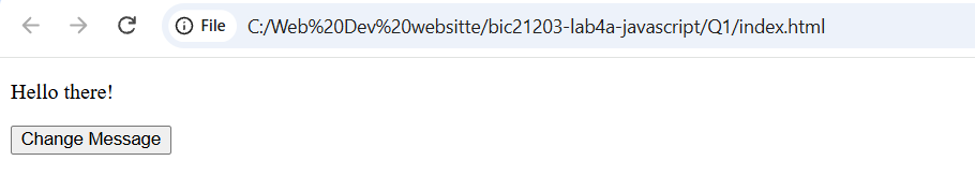
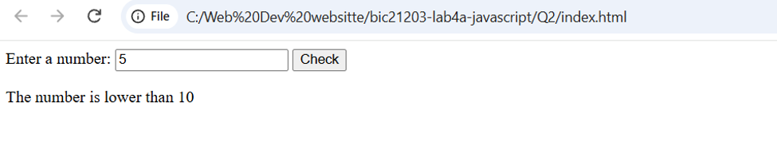
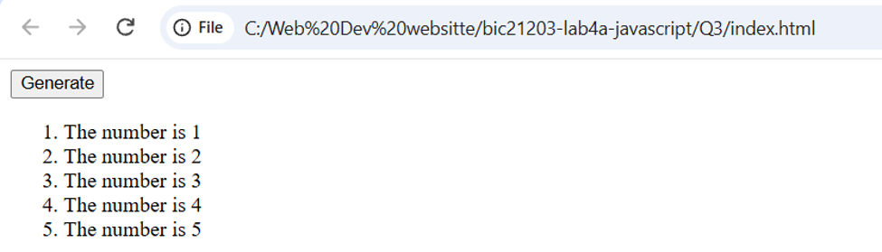

# BIC21203 Lab 4a: Client-Side Scripting (JavaScript)

**Student Name:** THANG JING LANG 
**Student ID:** [AI240141]  

## 📖 Project Overview
This repository contains solutions for Lab 4a, focusing on modern client-side JavaScript. The exercises demonstrate practical applications of DOM manipulation, event handling, conditional logic (input validation), and iteration (loops) without relying on external libraries.

## 📂 Folder Structure & Explanations

### Q1: Interactive Text Changer
- **Concept:** DOM selection and Event Listeners.
- **Description:** Uses `document.getElementById` and an `addEventListener` to detect button clicks. Upon clicking, a JavaScript function dynamically replaces the paragraph's `textContent` from the default welcome message to a new greeting.

### Q2: Smart Number Validator
- **Concept:** Conditional logic and Input Validation.
- **Description:** Reads user input and processes it using an `if...else if...else` structure. It actively sanitizes the data by trimming whitespace, checking for empty strings, and using `isNaN()` to reject alphabetical characters before evaluating if the numeric value is less than, equal to, or greater than 10.

### Q3: Dynamic Number Generator
- **Concept:** `for` loops and Dynamic DOM Element Creation.
- **Description:** Generates an ordered list from 1 to 5 dynamically. It uses a `for` loop alongside `document.createElement()` to build `<li>` nodes in memory before appending them to the DOM. It also clears the container's `innerHTML` upon execution to prevent list duplication on repeated clicks.

## 🚀 How to Run
1. Navigate into the `Q1`, `Q2`, or `Q3` directory.
2. Double-click the `index.html` file to open it in any modern desktop web browser.
3. Interact with the UI elements (buttons and text fields) to execute the JavaScript functions.

## 📸 Output Screenshots

### Question 1 Output

### Question 2 Output

### Question 3 Output
